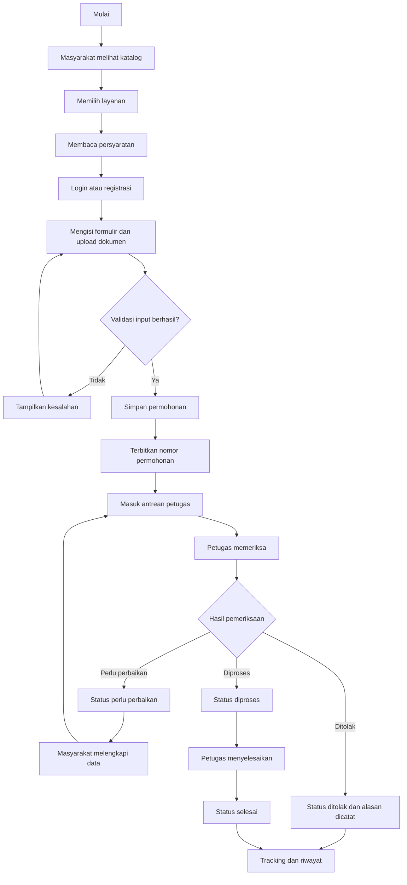
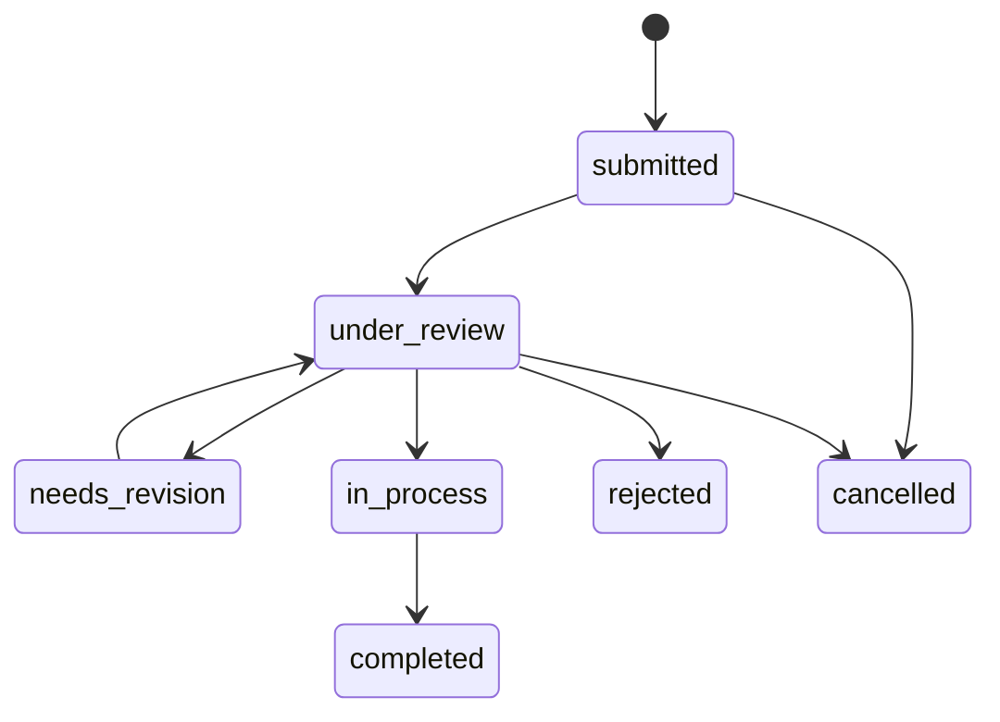
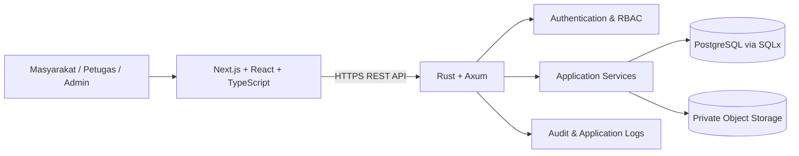
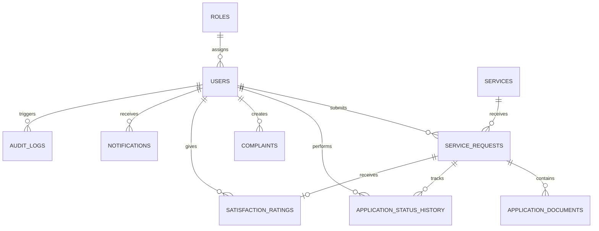

# PRODUCT REQUIREMENT DOCUMENT (PRD)
# BANDAR LAYAN
## Smart Public Service – Studi Kasus Kota Bandar Lampung

**Versi:** 1.0 – Draft Konsolidasi untuk Validasi  
**Tanggal:** 10 November 2026  
**Status:** Dokumen gabungan; belum menjadi baseline final sebelum validasi kebutuhan  
**Platform:** Aplikasi web responsif  
**Pemilik dokumen:** Nama Mahasiswa – Program Studi Sistem Informasi, Universitas Teknokrat Indonesia  
**Teknologi inti:** Next.js, React, TypeScript, Tailwind CSS, Rust, Axum, SQLx, PostgreSQL

---

## Kontrol dan status dokumen

| Atribut | Keterangan |
|---|---|
| Nama produk | BANDAR LAYAN |
| Jenis dokumen | Product Requirement Document |
| Versi | 1.0 – Draft Konsolidasi |
| Pendekatan | MVP-first, user journey, requirement traceability |
| Studi kasus | Kota Bandar Lampung |
| Audiens | Product owner, analis sistem, UI/UX, frontend, backend, database, QA, security, dan deployment |
| Sumber konsolidasi | PRD BANDAR LAYAN versi 0.9 dan PRD alternatif berorientasi MVP |
| Status validasi | Menunggu pencocokan dengan hasil brainstorming asli dan konfirmasi pemangku kepentingan |

> **Catatan penting mengenai sumber dan asumsi:** Dua dokumen sebelumnya telah dikonsolidasikan menjadi satu struktur. Materi yang tersedia menjelaskan konsep Smart Public Service, tiga role utama, alur layanan, teknologi, contoh entitas data, dan kebutuhan teknis. Namun, daftar atau artefak hasil brainstorming asli belum tersedia dalam materi yang dapat diperiksa. Karena itu, rincian yang belum ditetapkan ditandai sebagai **usulan**, **asumsi**, atau **perlu validasi**. Dokumen ini tidak menyatakan bahwa BANDAR LAYAN telah terintegrasi dengan sistem resmi Pemerintah Kota Bandar Lampung atau instansi lain.

## Riwayat perubahan

| Versi | Perubahan | Status |
|---|---|---|
| 0.9 | PRD komprehensif awal: kebutuhan, arsitektur, keamanan, database, API, dan deployment | Draft |
| Alternatif 1.0 | Penataan ulang dengan fokus MVP, user journey, acceptance criteria, dan traceability | Draft |
| 1.0 | Konsolidasi dua pendekatan, penyelarasan istilah, prioritas, workflow, dan validasi | Draft untuk validasi |

---

# 1. Ringkasan Eksekutif

BANDAR LAYAN adalah prototipe aplikasi web **Smart Public Service** untuk studi kasus Kota Bandar Lampung. Aplikasi dirancang sebagai kanal digital terpusat agar masyarakat dapat memperoleh informasi layanan publik, memahami persyaratan, mengajukan permohonan, mengunggah dokumen, memantau status permohonan, menyampaikan pengaduan, dan memberikan penilaian terhadap layanan.

Dari sisi operasional, petugas pelayanan dapat melihat permohonan sesuai kewenangannya, memeriksa kelengkapan, memberikan catatan tindak lanjut, dan memperbarui status. Administrator mengelola akun, role, katalog layanan, serta melihat ringkasan aktivitas dan audit.

Produk dikembangkan sebagai prototipe mahasiswa. Fokusnya adalah membuktikan alur layanan digital yang konsisten, mudah digunakan, aman pada tingkat prototipe, dan dapat diuji. Produk ini bukan pengganti kanal resmi pemerintah, bukan sistem penerbitan dokumen hukum, dan tidak mengklaim adanya integrasi resmi tanpa API, izin, serta kerja sama yang sah.

## 1.1 Visi

Menyediakan pengalaman pelayanan publik digital yang lebih mudah dipahami, tertata, dan transparan melalui satu alur dari pencarian informasi hingga pemantauan tindak lanjut.

## 1.2 Misi

1. Menyatukan informasi layanan dan persyaratan dalam katalog yang mudah dipahami.
2. Menyediakan alur pengajuan permohonan dan pengunggahan dokumen yang terstruktur.
3. Memberikan transparansi status dan riwayat permohonan.
4. Membantu petugas mengelola antrean dan tindak lanjut secara terorganisasi.
5. Menyediakan kanal pengaduan dan umpan balik.
6. Menjaga keamanan data, pembatasan akses, dan keterlacakan aktivitas penting.

## 1.3 Proposisi nilai

Nilai utama BANDAR LAYAN bukan pada pengambilan keputusan pemerintah secara otomatis, melainkan pada konsistensi informasi, keteraturan data permohonan, pengalaman pengguna yang lebih jelas, dan transparansi proses di dalam ruang lingkup prototipe.

---

# 2. Latar Belakang, Masalah, dan Tujuan

## 2.1 Pernyataan masalah

Bagaimana merancang aplikasi web prototipe yang memungkinkan masyarakat mengakses informasi dan mengajukan layanan secara terstruktur, sekaligus menyediakan sarana bagi petugas dan administrator untuk mengelola permohonan, layanan, pengguna, dan jejak tindak lanjut secara aman?

## 2.2 Hipotesis masalah yang hendak diuji

Masalah berikut merupakan hipotesis desain yang perlu dikonfirmasi melalui wawancara atau pengujian calon pengguna, bukan klaim hasil riset lapangan:

- Informasi layanan dan persyaratan dapat tersebar di beberapa kanal sehingga masyarakat perlu mencari dari berbagai sumber.
- Masyarakat membutuhkan kejelasan tentang data dan dokumen yang harus disiapkan sebelum mengajukan permohonan.
- Pemohon membutuhkan cara untuk mengetahui perkembangan permohonan tanpa harus menanyakan status secara berulang.
- Petugas membutuhkan daftar kerja yang lebih terstruktur untuk memeriksa dan memperbarui permohonan.
- Pengelola membutuhkan data layanan dan pengguna yang konsisten serta jejak aktivitas yang dapat ditelusuri.

## 2.3 Tujuan produk

| ID | Tujuan | Hasil yang diharapkan |
|---|---|---|
| OBJ-01 | Memudahkan penemuan informasi layanan | Masyarakat dapat melihat deskripsi, persyaratan, dan alur layanan |
| OBJ-02 | Menyediakan pengajuan digital | Permohonan dan dokumen tersimpan secara terstruktur |
| OBJ-03 | Menyediakan tracking | Pemohon dapat melihat status dan riwayat milik sendiri |
| OBJ-04 | Mendukung pekerjaan petugas | Petugas dapat memeriksa dan memperbarui permohonan sesuai kewenangan |
| OBJ-05 | Mendukung administrasi sistem | Administrator dapat mengelola pengguna, role, dan katalog layanan |
| OBJ-06 | Menyediakan umpan balik | Masyarakat dapat mengirim pengaduan dan penilaian sesuai aturan |
| OBJ-07 | Menjaga keterlacakan | Perubahan status dan aktivitas penting tercatat |

## 2.4 Bukan tujuan produk

- Menggantikan seluruh kanal resmi pelayanan pemerintah.
- Menerbitkan dokumen pemerintah yang sah atau mengambil keputusan hukum.
- Menghubungkan aplikasi ke sistem Pemkot atau instansi lain tanpa API, izin, dan persetujuan resmi.
- Menjamin SLA pelayanan nyata atau ketersediaan produksi.
- Menggunakan AI untuk memutuskan kelayakan permohonan secara otomatis pada MVP.
- Mengumpulkan data pribadi yang tidak diperlukan untuk skenario layanan prototipe.

---

# 3. Pengguna, Persona, dan Hak Akses

## 3.1 Role utama

| Role | Kebutuhan inti | Hak akses | Batasan |
|---|---|---|---|
| Masyarakat | Informasi layanan, pengajuan, dokumen, tracking, pengaduan, rating, profil | Data layanan publik dan data permohonan milik sendiri | Tidak dapat melihat data pemohon lain atau mengubah status internal |
| Petugas Pelayanan | Antrean kerja, pemeriksaan, catatan, pembaruan status | Permohonan yang berada dalam lingkup kewenangannya | Tidak dapat mengelola role administrator atau katalog kecuali diberi kewenangan terpisah |
| Administrator | Pengguna, role, katalog layanan, ringkasan, audit | Fungsi administrasi sistem yang ditetapkan | Tidak otomatis mengambil keputusan substantif atas permohonan |

**Prinsip otorisasi:** akses harus diperiksa di backend pada setiap endpoint dan objek. Menyembunyikan tombol atau halaman di frontend tidak cukup untuk melindungi data.

## 3.2 Persona konseptual

| Persona | Konteks | Tujuan | Kebutuhan utama |
|---|---|---|---|
| Warga/pemohon | Membutuhkan informasi dan mengajukan layanan | Menyelesaikan pengajuan serta mengetahui perkembangannya | Katalog yang jelas, formulir sederhana, upload, tracking |
| Petugas | Menangani permohonan | Memeriksa data dan memberi tindak lanjut | Antrean, detail permohonan, catatan, riwayat |
| Administrator | Mengelola aplikasi | Menjaga data master dan akses | Manajemen akun, role, layanan, audit, ringkasan |

Persona ini bersifat konseptual dan perlu diperbaiki berdasarkan wawancara pengguna nyata.

## 3.3 Matriks hak akses ringkas

| Fitur | Masyarakat | Petugas | Administrator |
|---|---:|---:|---:|
| Melihat katalog layanan aktif | Ya | Ya | Ya |
| Mengajukan permohonan | Ya | Tidak sebagai fungsi petugas | Tidak sebagai fungsi admin |
| Melihat permohonan sendiri | Ya | Jika ditugaskan/berwenang | Sesuai kebutuhan administrasi |
| Melihat seluruh permohonan | Tidak | Tidak, kecuali kewenangan unit mengizinkan | Sesuai kebijakan |
| Mengubah status permohonan | Tidak | Ya, sesuai kewenangan dan transisi | Tidak otomatis; perlu kebijakan eksplisit |
| Mengelola katalog layanan | Tidak | Tidak, kecuali kewenangan khusus | Ya |
| Mengelola pengguna dan role | Tidak | Tidak | Ya |
| Membuat pengaduan | Ya | Tidak sebagai pemohon | Tidak sebagai pemohon |
| Menangani pengaduan | Tidak | Ya, sesuai kewenangan | Administratif sesuai kebijakan |
| Memberikan rating | Ya, sesuai aturan | Tidak | Tidak |
| Melihat audit log | Tidak | Terbatas bila diperlukan | Ya |

---

# 4. User Journey dan Alur Utama

## 4.1 Journey masyarakat

1. Masyarakat membuka aplikasi BANDAR LAYAN.
2. Masyarakat melihat katalog layanan dan informasi persyaratan.
3. Masyarakat memilih layanan yang dibutuhkan.
4. Sistem menampilkan detail, persyaratan, dan formulir terkait.
5. Masyarakat login atau registrasi jika belum memiliki akun.
6. Masyarakat mengisi formulir dan mengunggah dokumen.
7. Sistem memvalidasi input dan menyimpan permohonan.
8. Sistem menghasilkan nomor permohonan unik.
9. Masyarakat melihat status dan riwayat permohonan.
10. Jika ada permintaan perbaikan, masyarakat melengkapi data sesuai instruksi.
11. Setelah permohonan selesai, masyarakat dapat memberikan penilaian sesuai aturan yang ditetapkan.

## 4.2 Journey petugas

1. Petugas login.
2. Sistem menampilkan antrean permohonan sesuai lingkup kewenangan.
3. Petugas membuka detail permohonan.
4. Petugas memeriksa data dan dokumen.
5. Petugas memilih tindakan yang sah: menerima untuk diproses, meminta perbaikan, menolak dengan alasan, atau menandai selesai sesuai workflow yang disetujui.
6. Sistem menyimpan perubahan status dan riwayat.
7. Masyarakat dapat melihat pembaruan status pada halaman tracking.

## 4.3 Journey administrator

1. Administrator login.
2. Administrator mengelola akun dan role.
3. Administrator membuat atau memperbarui katalog layanan.
4. Administrator mengaktifkan atau menonaktifkan layanan.
5. Administrator melihat ringkasan data dan audit aktivitas.
6. Administrator memastikan perubahan konfigurasi tercatat.

## 4.4 Diagram alur permohonan

---

# 5. Ruang Lingkup dan Prioritas Produk

## 5.1 Prinsip prioritas

Pengembangan dilakukan bertahap. MVP harus menyelesaikan alur inti dari penemuan layanan hingga tracking dan pengelolaan permohonan. Fitur tambahan tidak boleh menghambat alur inti.

- **Must Have (MVP):** wajib tersedia agar alur utama dapat diuji.
- **Should Have:** penting, tetapi dapat masuk iterasi setelah alur inti stabil.
- **Could Have:** peningkatan yang dapat ditunda.
- **Out of Scope:** tidak dikerjakan dalam ruang lingkup prototipe saat ini.

## 5.2 Prioritas modul

| Modul | Fitur | Prioritas | Catatan |
|---|---|---|---|
| Autentikasi | Registrasi, login, logout | Must Have | Metode verifikasi akun perlu diputuskan |
| Profil | Melihat dan memperbarui profil dasar | Should Have | Minimalkan data pribadi |
| Katalog layanan | Daftar dan detail layanan aktif | Must Have | Informasi dan persyaratan dapat dikelola admin |
| Pengajuan | Formulir dan penyimpanan permohonan | Must Have | Form disesuaikan dengan layanan contoh |
| Dokumen | Upload dan metadata dokumen | Must Have | File privat; batas ukuran/jenis perlu diputuskan |
| Tracking | Status dan riwayat permohonan | Must Have | Hanya pemilik atau petugas berwenang |
| Dashboard petugas | Antrean dan detail permohonan | Must Have | Harus menerapkan scope kewenangan |
| Pengelolaan status | Transisi status dan catatan | Must Have | Menggunakan aturan transisi yang eksplisit |
| Administrasi | CRUD katalog layanan dan manajemen akun/role | Must Have | Aksi sensitif dicatat |
| Pengaduan | Membuat dan melihat pengaduan sendiri | Should Have | Workflow penanganan perlu divalidasi |
| Penilaian | Rating setelah permohonan selesai | Should Have | Aturan satu rating per permohonan adalah usulan |
| Notifikasi in-app | Pemberitahuan perubahan status | Should Have | Kanal eksternal tidak termasuk MVP |
| Statistik | Ringkasan jumlah permohonan dan status | Should Have | Data agregat, bukan klaim kinerja layanan publik |
| Audit log | Catatan aktivitas penting | Must Have untuk aksi sensitif | Retensi dan akses perlu ditetapkan |
| Integrasi resmi | Integrasi API instansi pemerintah | Out of Scope | Membutuhkan API dan izin resmi |
| Pembayaran | Pembayaran biaya layanan | Out of Scope | Tidak ada kebutuhan yang tervalidasi |
| Tanda tangan elektronik | TTE tersertifikasi | Out of Scope | Memerlukan penyedia dan dasar legal |
| AI keputusan | Penilaian otomatis kelayakan | Out of Scope | Risiko dan kebutuhan belum tervalidasi |

---

# 6. Kebutuhan Fungsional

Semua kebutuhan di bawah merupakan baseline konsolidasi. Prioritas dan detailnya perlu dicocokkan dengan hasil brainstorming asli.

| ID | Fitur | Deskripsi kebutuhan | Role | Prioritas |
|---|---|---|---|---|
| FR-01 | Registrasi | Masyarakat dapat membuat akun dengan data minimum yang diperlukan | Masyarakat | Must |
| FR-02 | Login/logout | Pengguna dapat masuk dan keluar dengan mekanisme autentikasi aman | Semua role | Must |
| FR-03 | RBAC dan otorisasi objek | Sistem membatasi fungsi berdasarkan role, kepemilikan, dan lingkup penugasan | Semua role | Must |
| FR-04 | Daftar layanan | Sistem menampilkan layanan aktif beserta ringkasan informasi | Semua role | Must |
| FR-05 | Detail layanan | Sistem menampilkan deskripsi, persyaratan, alur, dan informasi yang relevan | Semua role | Must |
| FR-06 | Buat permohonan | Masyarakat dapat mengisi dan mengirim formulir layanan | Masyarakat | Must |
| FR-07 | Upload dokumen | Masyarakat dapat mengunggah dokumen persyaratan yang diizinkan | Masyarakat | Must |
| FR-08 | Nomor permohonan | Sistem menghasilkan nomor unik setelah permohonan berhasil disimpan | Sistem | Must |
| FR-09 | Tracking | Masyarakat dapat melihat status dan riwayat permohonan miliknya | Masyarakat | Must |
| FR-10 | Daftar permohonan | Petugas dapat melihat daftar permohonan dalam lingkup kewenangannya | Petugas | Must |
| FR-11 | Detail dan pemeriksaan | Petugas dapat melihat data dan dokumen permohonan yang berwenang diakses | Petugas | Must |
| FR-12 | Pembaruan status | Petugas dapat mengubah status sesuai transisi yang diizinkan | Petugas | Must |
| FR-13 | Catatan tindak lanjut | Petugas dapat menambahkan catatan yang relevan untuk pemohon atau internal | Petugas | Must |
| FR-14 | Administrasi layanan | Administrator dapat membuat, melihat, mengubah, dan menonaktifkan layanan | Administrator | Must |
| FR-15 | Administrasi pengguna | Administrator dapat mengelola akun sesuai kebijakan | Administrator | Must |
| FR-16 | Pengaduan | Masyarakat dapat membuat dan melihat pengaduan miliknya | Masyarakat | Should |
| FR-17 | Penanganan pengaduan | Petugas berwenang dapat melihat dan memperbarui tindak lanjut pengaduan | Petugas | Should |
| FR-18 | Rating | Masyarakat dapat memberikan penilaian setelah kondisi yang ditentukan terpenuhi | Masyarakat | Should |
| FR-19 | Notifikasi in-app | Sistem menampilkan notifikasi untuk peristiwa penting | Masyarakat/Petugas | Should |
| FR-20 | Statistik | Administrator dapat melihat ringkasan data permohonan | Administrator | Should |
| FR-21 | Audit log | Sistem mencatat aktivitas sensitif dan perubahan penting | Sistem/Admin | Must |
| FR-22 | Profil | Pengguna dapat melihat dan memperbarui data profil yang diizinkan | Masyarakat | Should |

## 6.1 Detail perilaku penting

### FR-06 – Buat permohonan
- Sistem hanya menerima permohonan untuk layanan yang aktif.
- Field wajib dan validasi mengikuti konfigurasi layanan.
- Server memvalidasi ulang semua input; validasi frontend bukan satu-satunya kontrol.
- Penyimpanan permohonan dan nomor permohonan harus konsisten.
- Jika proses gagal, sistem tidak boleh menghasilkan permohonan setengah jadi.

### FR-07 – Upload dokumen
- File hanya dapat diunggah ke permohonan yang dimiliki pengguna atau berada dalam kewenangan petugas.
- Sistem memeriksa ekstensi, MIME type, ukuran, dan nama file.
- File disimpan di object storage privat atau media penyimpanan privat yang setara.
- Akses file dilakukan melalui endpoint terotorisasi atau signed URL berumur pendek.
- Batas ukuran, jenis file, scanning malware, dan retensi harus ditentukan sebelum produksi.

### FR-09 – Tracking
- Pemohon hanya dapat melihat permohonan miliknya.
- Status terkini dan riwayat harus konsisten.
- Riwayat menampilkan waktu perubahan dan keterangan yang aman untuk ditampilkan kepada pemohon.
- Catatan internal petugas tidak boleh bocor ke halaman masyarakat.

### FR-12 – Pembaruan status
- Backend memvalidasi status asal dan tujuan.
- Setiap perubahan status menyimpan riwayat.
- Perubahan status dan pencatatan riwayat dilakukan dalam satu transaksi database.
- Perubahan ditolak jika transisi tidak sah atau petugas tidak memiliki kewenangan.

### FR-21 – Audit log
- Catat aktor, jenis aksi, objek, waktu, dan metadata minimum yang diperlukan.
- Jangan mencatat password, token, isi dokumen, atau data pribadi sensitif yang tidak diperlukan.
- Retensi, akses, dan mekanisme penghapusan audit harus ditentukan.

---

# 7. Aturan Bisnis dan Workflow

## 7.1 Status permohonan

Status berikut merupakan **usulan workflow awal** dan harus dikonfirmasi dengan pemilik proses:

| Status | Makna |
|---|---|
| `submitted` | Permohonan berhasil dikirim |
| `under_review` | Sedang diperiksa petugas |
| `needs_revision` | Pemohon diminta memperbaiki atau melengkapi data |
| `in_process` | Permohonan sedang diproses |
| `rejected` | Permohonan ditolak dengan alasan yang dicatat |
| `completed` | Proses pada prototipe dinyatakan selesai |
| `cancelled` | Permohonan dibatalkan sesuai kebijakan |

## 7.2 Transisi status yang diusulkan

Transisi tambahan tidak boleh dibuat hanya dari UI. Setiap transisi harus didefinisikan pada domain/backend dan diuji.

## 7.3 Aturan bisnis awal

| ID | Aturan |
|---|---|
| BR-01 | Setiap permohonan memiliki ID internal dan nomor permohonan unik |
| BR-02 | Masyarakat hanya dapat melihat dan mengelola permohonan miliknya |
| BR-03 | Petugas hanya dapat mengakses permohonan sesuai lingkup kewenangannya |
| BR-04 | Hanya layanan aktif yang dapat menerima permohonan baru |
| BR-05 | Setiap perubahan status harus menyimpan riwayat |
| BR-06 | Status hanya dapat berubah melalui transisi yang diizinkan |
| BR-07 | Penolakan harus memiliki alasan yang dicatat |
| BR-08 | Permintaan perbaikan harus memiliki instruksi yang dapat dipahami pemohon |
| BR-09 | Dokumen tidak boleh disimpan pada direktori publik |
| BR-10 | Rating hanya dapat diberikan pada permohonan yang memenuhi kondisi yang ditetapkan |
| BR-11 | Perubahan role dan konfigurasi penting harus tercatat dalam audit log |
| BR-12 | Penghapusan data operasional mengikuti kebijakan retensi dan kebutuhan audit; soft delete dapat dipilih bila sesuai |

## 7.4 Keputusan workflow yang belum final

- Apakah petugas ditugaskan berdasarkan layanan, unit, wilayah, atau assignment manual?
- Apakah permohonan dapat dibatalkan setelah masuk tahap pemeriksaan?
- Apakah `rejected` dapat diajukan ulang sebagai permohonan baru atau dibuka kembali?
- Apakah pemohon wajib memverifikasi email atau nomor telepon?
- Apakah catatan petugas dibagi menjadi catatan publik dan catatan internal?
- Apakah pengaduan memiliki status dan workflow terpisah?

---

# 8. Kebutuhan Non-Fungsional

Target di bawah merupakan target awal pengujian prototipe, bukan jaminan layanan produksi.

| ID | Area | Kebutuhan / target awal |
|---|---|---|
| NFR-01 | Performance | Halaman utama dan katalog ditargetkan tampil dalam ≤3 detik pada lingkungan uji yang wajar; ukur dengan kondisi uji terdokumentasi |
| NFR-02 | API | Endpoint umum ditargetkan memiliki p95 ≤1 detik pada dataset dan lingkungan uji yang ditentukan, di luar proses upload |
| NFR-03 | Security | Password di-hash dengan algoritma adaptif seperti Argon2id; tidak ada plaintext password |
| NFR-04 | Authorization | Seluruh endpoint privat memeriksa autentikasi, role, ownership, dan assignment yang relevan |
| NFR-05 | File security | Dokumen privat, validasi tipe/ukuran, dan akses file terotorisasi |
| NFR-06 | Reliability | Operasi penting menggunakan transaksi database dan constraint |
| NFR-07 | Availability | Target availability produksi belum ditetapkan; prototipe diuji pada lingkungan demo |
| NFR-08 | Usability | Alur utama dapat diselesaikan oleh ≥80% peserta uji tanpa bantuan kritis sebagai target awal |
| NFR-09 | Responsive | Antarmuka dapat digunakan pada desktop dan perangkat mobile |
| NFR-10 | Compatibility | Mendukung browser modern berbasis Chromium, Firefox, dan Safari versi yang masih didukung |
| NFR-11 | Maintainability | Kode dipisah berdasarkan domain/fitur, memiliki linting, format konsisten, dan dokumentasi setup |
| NFR-12 | Scalability | Query memiliki indeks yang sesuai; pagination digunakan untuk daftar data |
| NFR-13 | Observability | Error backend dicatat tanpa membocorkan secret atau data pribadi |
| NFR-14 | Backup | Backup database dan prosedur restore ditetapkan sebelum penggunaan data penting |
| NFR-15 | Accessibility | Kontras, label input, fokus keyboard, dan pesan error diperhatikan; target formal perlu ditentukan |

---

# 9. Arsitektur Sistem dan Teknologi

## 9.1 Arsitektur konseptual

BANDAR LAY menggunakan pendekatan client-server. Frontend web berkomunikasi dengan backend melalui REST API. Backend menerapkan autentikasi, otorisasi, validasi domain, dan akses database. Dokumen disimpan pada penyimpanan privat.

## 9.2 Stack teknologi

| Lapisan | Teknologi | Alasan pemilihan / catatan |
|---|---|---|
| Frontend framework | Next.js | Pengembangan aplikasi web terstruktur dan opsi deployment frontend |
| UI library | React | Komponen antarmuka yang dapat digunakan kembali |
| Bahasa frontend | TypeScript | Pemeriksaan tipe dan kontrak data |
| Styling | Tailwind CSS | Konsistensi desain dan responsive layout |
| Backend language | Rust | Performa, sistem tipe, dan memory safety |
| HTTP framework | Axum | Routing dan handler async yang terstruktur |
| Database toolkit | SQLx | Query SQL terparameterisasi dan dukungan pemeriksaan query |
| Database | PostgreSQL | Transaksi, constraint, indeks, relasi, dan JSONB |
| Authentication | Cookie session atau JWT | Pilih satu pendekatan utama; rekomendasi awal cookie session untuk first-party web |
| Password hashing | Argon2id | Hash adaptif, bukan enkripsi reversibel |
| Frontend hosting | Vercel | Opsi deployment Next.js |
| Backend hosting | Platform kompatibel Rust atau container | Harus mendukung HTTPS, environment variables, health check, dan koneksi PostgreSQL |
| File storage | Object storage privat | Dokumen tidak ditempatkan pada public web root |

## 9.3 Rekomendasi autentikasi

Untuk aplikasi web first-party, rekomendasi awal adalah **session cookie** dengan atribut `HttpOnly`, `Secure`, dan `SameSite` yang sesuai, masa berlaku terbatas, serta perlindungan CSRF yang tepat.

Jika frontend dan backend berada pada domain berbeda, konfigurasi CORS credentials, cookie domain, `SameSite=None; Secure`, dan CSRF harus diuji pada deployment sebenarnya. Hindari penggunaan cookie session dan bearer JWT secara bersamaan tanpa kebutuhan arsitektural yang jelas.

## 9.4 Environment dan secret

- `NEXT_PUBLIC_API_BASE_URL` hanya berisi URL API publik, bukan secret.
- `DATABASE_URL`, `SESSION_SECRET`, kredensial object storage, dan secret lain hanya berada di environment backend.
- Pisahkan konfigurasi development, staging, dan production.
- Jangan commit file `.env` yang berisi secret.
- Gunakan HTTPS untuk seluruh komunikasi pada deployment publik.

## 9.5 Validasi teknis stack

| Kebutuhan | Teknologi | Cara implementasi | Status |
|---|---|---|---|
| REST API | Rust/Axum | Router, handler, middleware, domain service | Layak secara teknis; perlu implementasi dan uji |
| Akses database | SQLx/PostgreSQL | Query terparameterisasi, transaksi, migration | Layak secara teknis; query dan skema perlu diuji |
| Autentikasi | Axum + session store | Hash password, session, expiry, revocation | Layak; pilihan session store dan konfigurasi perlu diputuskan |
| RBAC | Axum middleware + domain service | Pemeriksaan role, ownership, dan assignment di backend | Layak; wajib diuji dengan skenario negatif |
| Upload | Axum multipart + object storage | Validasi file, simpan object privat, metadata di DB | Layak bersyarat; perlu keputusan storage dan batas file |
| Frontend/API | Next.js + REST | HTTP client, kontrak JSON, error handling | Layak; CORS dan cookie diuji saat deployment |
| Deployment frontend | Vercel | Build Next.js dan environment config | Layak; konfigurasi domain perlu diuji |
| Deployment backend | Hosting Rust/container | HTTPS, health check, secrets, DB connectivity | Bergantung pada provider yang dipilih |
| Notifikasi in-app | PostgreSQL + service layer | Buat notifikasi setelah event domain berhasil | Layak; bukan email/SMS/push |

---

# 10. Kebutuhan Database

## 10.1 Prinsip perancangan

- Gunakan primary key yang stabil, disarankan UUID.
- Terapkan foreign key dan constraint untuk menjaga integritas.
- Gunakan transaksi untuk operasi yang mengubah status dan riwayat.
- Simpan file di object storage privat; database hanya menyimpan metadata dan object key.
- Tambahkan indeks pada kolom yang sering digunakan untuk pencarian, filter, dan relasi.
- Gunakan `JSONB` hanya untuk atribut formulir yang memang dinamis dan telah memiliki validasi skema.
- Hindari menyimpan data pribadi yang tidak diperlukan.

## 10.2 Entitas inti

| Tabel | Fungsi | Kolom penting (konseptual) |
|---|---|---|
| `roles` | Master role | `id`, `name`, `description` |
| `users` | Akun pengguna | `id`, `role_id`, `name`, `email`, `password_hash`, `is_active`, timestamps |
| `services` | Katalog layanan | `id`, `name`, `slug`, `description`, `requirements`, `is_active`, timestamps |
| `service_requests` | Permohonan layanan | `id`, `request_number`, `user_id`, `service_id`, `status`, `form_data`, timestamps |
| `application_documents` | Metadata dokumen | `id`, `request_id`, `uploaded_by`, `original_name`, `object_key`, `mime_type`, `size_bytes`, timestamps |
| `application_status_history` | Riwayat status | `id`, `request_id`, `actor_id`, `from_status`, `to_status`, `public_note`, `internal_note`, `created_at` |
| `complaints` | Pengaduan | `id`, `user_id`, `subject`, `description`, `status`, timestamps |
| `satisfaction_ratings` | Penilaian | `id`, `request_id`, `user_id`, `score`, `comment`, `created_at` |
| `notifications` | Notifikasi in-app | `id`, `user_id`, `title`, `body`, `read_at`, `created_at` |
| `audit_logs` | Audit aktivitas | `id`, `actor_id`, `action`, `entity_type`, `entity_id`, `metadata`, `created_at` |

**Catatan skema:** Kolom di atas adalah rancangan konseptual, bukan migration final. Kolom assignment petugas/unit, verifikasi akun, lampiran pengaduan, dan konfigurasi formulir perlu ditambahkan jika keputusan kebutuhan mengharuskannya.

## 10.3 Relasi ERD

Relasi `SERVICE_REQUESTS` ke `SATISFACTION_RATINGS` digambarkan satu-ke-nol/atau-satu sebagai **usulan**. Jika aturan bisnis mengizinkan beberapa rating atau survei, constraint harus disesuaikan.

## 10.4 Constraint dan indeks yang disarankan

- `users.email` unik setelah normalisasi.
- `services.slug` unik.
- `service_requests.request_number` unik.
- `satisfaction_ratings.score` dibatasi, misalnya 1 sampai 5.
- Jika satu rating per permohonan disetujui, terapkan unique constraint pada `request_id`.
- `application_documents.request_id` memiliki foreign key ke `service_requests`.
- Indeks pada `service_requests(user_id, created_at)`, `service_requests(status, created_at)`, `service_requests(service_id)`, dan kolom assignment jika digunakan.
- Gunakan constraint dan transaksi untuk menjaga konsistensi status dan riwayat.

---

# 11. REST API Requirements

Daftar berikut adalah kontrak awal tingkat endpoint. Format request/response detail, pagination, error schema, dan versi API perlu ditetapkan dalam spesifikasi teknis.

| Endpoint | Method | Fungsi | Akses |
|---|---|---|---|
| `/api/v1/auth/register` | POST | Registrasi akun masyarakat | Publik |
| `/api/v1/auth/login` | POST | Login | Publik |
| `/api/v1/auth/logout` | POST | Logout dan invalidasi sesi | Pengguna login |
| `/api/v1/auth/me` | GET | Profil dan role pengguna aktif | Pengguna login |
| `/api/v1/services` | GET | Daftar layanan aktif | Publik |
| `/api/v1/services/{id}` | GET | Detail layanan | Publik |
| `/api/v1/service-requests` | POST | Membuat permohonan | Masyarakat |
| `/api/v1/service-requests` | GET | Daftar permohonan sesuai scope | Masyarakat/Petugas |
| `/api/v1/service-requests/{id}` | GET | Detail permohonan sesuai otorisasi | Pemilik/Petugas berwenang |
| `/api/v1/service-requests/{id}/documents` | POST | Upload dokumen | Pemilik |
| `/api/v1/service-requests/{id}/documents/{docId}` | GET | Akses dokumen terotorisasi | Pemilik/Petugas berwenang |
| `/api/v1/service-requests/{id}/history` | GET | Riwayat status | Pemilik/Petugas berwenang |
| `/api/v1/service-requests/{id}/status` | PATCH | Pembaruan status | Petugas berwenang |
| `/api/v1/complaints` | POST | Membuat pengaduan | Masyarakat |
| `/api/v1/complaints` | GET | Melihat pengaduan sesuai scope | Masyarakat/Petugas |
| `/api/v1/service-requests/{id}/rating` | POST | Memberikan rating | Pemilik yang memenuhi syarat |
| `/api/v1/notifications` | GET | Daftar notifikasi | Pengguna login |
| `/api/v1/notifications/{id}/read` | PATCH | Menandai notifikasi dibaca | Pemilik notifikasi |
| `/api/v1/admin/users` | GET/POST | Daftar atau membuat akun sesuai kebijakan | Administrator |
| `/api/v1/admin/users/{id}` | PATCH | Memperbarui akun/role | Administrator |
| `/api/v1/admin/services` | POST | Membuat layanan | Administrator |
| `/api/v1/admin/services/{id}` | PATCH | Memperbarui layanan | Administrator |
| `/api/v1/admin/services/{id}` | DELETE | Menonaktifkan/menghapus layanan sesuai kebijakan | Administrator |
| `/api/v1/admin/statistics` | GET | Ringkasan statistik | Administrator |
| `/api/v1/admin/audit-logs` | GET | Melihat audit log | Administrator |

## 11.1 Standar API

- Gunakan prefix versi, misalnya `/api/v1`.
- Gunakan HTTP status code secara konsisten: `200`, `201`, `204`, `400`, `401`, `403`, `404`, `409`, `422`, `429`, dan `500` sesuai kondisi.
- Validasi request pada backend.
- Gunakan pagination dan filter untuk daftar data.
- Jangan mengembalikan `object_key` atau kredensial storage kepada client.
- Pesan error tidak boleh membocorkan query, stack trace, secret, atau data pengguna lain.
- Gunakan transaksi untuk pembuatan permohonan dan pembaruan status yang membutuhkan konsistensi.
- Terapkan rate limiting pada endpoint autentikasi dan endpoint yang rentan disalahgunakan.

---

# 12. Keamanan dan Privasi

## 12.1 Kontrol minimum

1. Password disimpan sebagai hash Argon2id, bukan plaintext.
2. Session/token memiliki masa berlaku dan mekanisme invalidasi.
3. Cookie autentikasi menggunakan atribut keamanan yang sesuai.
4. Backend menerapkan RBAC serta pemeriksaan ownership dan assignment.
5. Semua input divalidasi dan query database menggunakan parameter binding.
6. Dokumen disimpan privat dan hanya dapat diakses melalui pemeriksaan otorisasi.
7. Batasi ukuran request dan file upload.
8. Cegah IDOR dengan memeriksa hak akses terhadap objek pada setiap request.
9. Terapkan proteksi CSRF jika menggunakan cookie session.
10. Terapkan CORS dengan origin yang spesifik, bukan wildcard untuk request berkredensial.
11. Secret hanya disimpan pada environment aman.
12. Audit log tidak menyimpan password, token, atau isi dokumen.
13. Gunakan HTTPS pada seluruh deployment publik.
14. Sediakan backup dan uji restore untuk database.

## 12.2 Privasi data

- Kumpulkan data sesuai kebutuhan layanan contoh.
- Jelaskan tujuan pengumpulan data pada UI.
- Batasi akses berdasarkan kebutuhan tugas.
- Tentukan masa retensi dan prosedur penghapusan sebelum memakai data nyata.
- Gunakan data sintetis untuk demo dan pengujian jika tidak diperlukan data nyata.
- Jangan menggunakan data pribadi warga tanpa dasar, izin, dan pengamanan yang sesuai.

## 12.3 Threats yang wajib diuji

| Ancaman | Kontrol / pengujian |
|---|---|
| IDOR | Uji akses permohonan dan dokumen milik akun lain |
| Privilege escalation | Uji perubahan role dan akses endpoint admin |
| Brute force | Rate limiting dan kebijakan login |
| File upload berbahaya | Validasi MIME, ekstensi, ukuran, dan scanning jika tersedia |
| SQL injection | SQLx parameter binding dan pengujian input |
| CSRF | Token/pola proteksi sesuai metode autentikasi |
| XSS | Output encoding dan sanitasi konten yang ditampilkan |
| Kebocoran secret | Pemeriksaan repository, build, dan log |
| Kebocoran dokumen | Uji akses langsung URL file tanpa otorisasi |

---

# 13. UI/UX dan Daftar Halaman

## 13.1 Prinsip desain

- Bahasa antarmuka menggunakan Bahasa Indonesia yang sederhana.
- Informasi persyaratan ditampilkan sebelum pengguna memulai pengajuan.
- Formulir dikelompokkan secara logis dan memberikan validasi yang jelas.
- Status menggunakan label dan penjelasan yang konsisten.
- Setiap halaman memiliki loading, empty, success, dan error state.
- Layout responsif untuk desktop dan perangkat mobile.
- Aksesibilitas dasar diperhatikan: label input, fokus keyboard, kontras, dan pesan kesalahan.

## 13.2 Halaman masyarakat

| Halaman | Tujuan |
|---|---|
| Beranda | Ringkasan produk dan akses ke layanan |
| Katalog layanan | Menelusuri layanan aktif |
| Detail layanan | Membaca deskripsi, persyaratan, dan alur |
| Registrasi | Membuat akun |
| Login | Autentikasi |
| Dashboard masyarakat | Ringkasan permohonan dan notifikasi |
| Form pengajuan | Mengisi data permohonan dan upload |
| Daftar permohonan | Melihat permohonan milik sendiri |
| Detail/tracking | Melihat status, riwayat, dan tindak lanjut |
| Pengaduan | Membuat dan melihat pengaduan sendiri |
| Penilaian | Memberikan rating bila memenuhi syarat |
| Profil | Melihat dan mengubah data yang diizinkan |

## 13.3 Halaman petugas

| Halaman | Tujuan |
|---|---|
| Dashboard petugas | Ringkasan antrean sesuai kewenangan |
| Daftar permohonan | Filter dan pencarian permohonan |
| Detail permohonan | Memeriksa data dan dokumen |
| Panel tindak lanjut | Memperbarui status dan catatan |
| Pengaduan | Melihat dan menindaklanjuti pengaduan sesuai kewenangan |

## 13.4 Halaman administrator

| Halaman | Tujuan |
|---|---|
| Dashboard admin | Ringkasan sistem |
| Manajemen pengguna | Mengelola akun |
| Manajemen role | Mengelola role sesuai kebijakan |
| Manajemen layanan | CRUD katalog layanan |
| Statistik | Ringkasan data permohonan |
| Audit log | Menelusuri aktivitas penting |

---

# 14. Acceptance Criteria

Kriteria berikut digunakan untuk menyatakan fitur dapat diterima pada lingkungan pengujian.

| ID | Skenario | Kriteria penerimaan |
|---|---|---|
| AC-01 | Registrasi valid | Akun tersimpan dan password tidak tersimpan sebagai plaintext |
| AC-02 | Login valid/tidak valid | Login valid berhasil; kredensial salah ditolak dengan pesan aman |
| AC-03 | Akses lintas role | Pengguna tidak dapat mengakses fungsi di luar kewenangannya |
| AC-04 | Katalog layanan | Hanya layanan aktif tampil pada katalog publik |
| AC-05 | Pengajuan valid | Permohonan tersimpan dan nomor unik dihasilkan |
| AC-06 | Pengajuan tidak valid | Validasi server menolak input yang tidak memenuhi aturan |
| AC-07 | Upload dokumen | File yang diizinkan tersimpan privat dan metadata tercatat |
| AC-08 | Tracking pemilik | Pemohon melihat status dan riwayat permohonannya sendiri |
| AC-09 | IDOR | Pemohon tidak dapat melihat permohonan/dokumen milik pengguna lain |
| AC-10 | Antrean petugas | Petugas hanya melihat permohonan dalam lingkup kewenangannya |
| AC-11 | Update status sah | Status berubah dan history tercatat dalam satu transaksi |
| AC-12 | Update status tidak sah | Transisi ilegal atau aktor tanpa hak ditolak |
| AC-13 | CRUD layanan | Administrator dapat mengelola katalog; perubahan tercatat |
| AC-14 | Pengaduan | Masyarakat dapat membuat dan melihat pengaduan sendiri |
| AC-15 | Rating | Rating hanya dapat dibuat jika aturan kelayakan terpenuhi |
| AC-16 | Audit | Aksi sensitif tercatat tanpa menyimpan secret |
| AC-17 | Responsif | Alur inti dapat digunakan pada viewport desktop dan mobile |
| AC-18 | Error state | UI menampilkan loading, empty, success, dan error state yang sesuai |

## 14.1 Contoh acceptance test Given-When-Then

**AC-09 – Pemohon tidak dapat mengakses permohonan pengguna lain**

- **Given:** Pengguna A dan Pengguna B memiliki akun, dan permohonan milik Pengguna B tersimpan.
- **When:** Pengguna A meminta detail permohonan Pengguna B menggunakan ID permohonan tersebut.
- **Then:** Backend menolak akses dengan respons yang sesuai dan tidak mengembalikan data privat.

**AC-11 – Pembaruan status menyimpan riwayat**

- **Given:** Petugas berwenang membuka permohonan dengan status `under_review`.
- **When:** Petugas mengubah status ke `in_process` melalui transisi yang diizinkan.
- **Then:** Status terkini berubah dan satu record riwayat tercatat secara konsisten dalam transaksi.

**AC-12 – Transisi status ilegal ditolak**

- **Given:** Permohonan berada pada status `submitted`.
- **When:** Petugas mencoba mengubah status langsung ke status yang tidak diizinkan oleh state machine.
- **Then:** Backend menolak perubahan dan status serta riwayat tetap konsisten.

---

# 15. Pengujian dan Evaluasi

## 15.1 Strategi pengujian

| Jenis uji | Fokus |
|---|---|
| Unit test | Validasi, aturan status, fungsi domain |
| Integration test | API, database, transaksi, autentikasi |
| Authorization test | Role, ownership, assignment, IDOR |
| File upload test | Tipe, ukuran, akses privat, file tidak valid |
| UI test | Alur formulir, tracking, error state |
| Responsive test | Desktop dan mobile |
| Usability test | Kejelasan katalog, pengajuan, tracking |
| Deployment test | Environment, HTTPS, CORS, koneksi database, health check |
| Backup/restore test | Pemulihan database dari backup |

## 15.2 Metrik keberhasilan prototipe

| Outcome | Indikator | Target awal | Sumber pengukuran |
|---|---|---|---|
| Pengajuan berjalan baik | Skenario submit valid berhasil | ≥95% skenario valid | Log dan database pengujian |
| Status dapat ditelusuri | Status UI sama dengan database/history | 100% kasus uji tracking | Integration test |
| Petugas dapat mengelola permohonan | Task success petugas | ≥90% tugas uji internal | Observasi task testing |
| Akses terkendali | Skenario negatif akses ditolak | 100% skenario negatif yang diuji | Security test |
| Antarmuka mudah dipahami | Peserta menyelesaikan alur utama tanpa bantuan kritis | ≥80% peserta uji | Usability test |
| Kepuasan prototipe | Rata-rata skor evaluasi pengalaman | ≥4/5 | Kuesioner setelah uji |

Target ini merupakan target evaluasi prototipe, bukan janji performa layanan pemerintah. Ukuran sampel, skenario, periode, perangkat, dan lingkungan pengujian harus dicatat.

---

# 16. Deployment dan Operasional

## 16.1 Lingkungan

| Lingkungan | Tujuan |
|---|---|
| Development | Pengembangan lokal |
| Staging/demo | Pengujian integrasi dan demonstrasi |
| Production | Belum menjadi target wajib prototipe; memerlukan keputusan dan hardening tambahan |

## 16.2 Rekomendasi deployment

- Frontend Next.js dapat dideploy ke Vercel.
- Backend Rust/Axum dideploy pada layanan yang mendukung binary Rust atau container.
- PostgreSQL menggunakan layanan database yang dapat diakses backend melalui koneksi aman.
- Dokumen disimpan pada object storage privat.
- Konfigurasi CORS, cookie, domain, dan HTTPS diuji pada domain deployment sebenarnya.
- Sediakan endpoint health check untuk backend.
- Migration database dijalankan melalui proses deployment yang terkendali.
- Backup database dan prosedur restore didokumentasikan.

## 16.3 Checklist sebelum demo publik

- [ ] Tidak ada secret di repository atau bundle frontend.
- [ ] HTTPS aktif.
- [ ] CORS hanya mengizinkan origin yang diperlukan.
- [ ] Akun demo dan role telah disiapkan dengan data sintetis.
- [ ] Endpoint privat telah diuji untuk IDOR dan privilege escalation.
- [ ] Dokumen tidak dapat diakses melalui URL publik tanpa otorisasi.
- [ ] Error tidak menampilkan stack trace atau secret.
- [ ] Database migration berhasil.
- [ ] Backup dan restore telah diuji untuk data penting.
- [ ] Halaman memiliki loading, empty, success, dan error state.
- [ ] Informasi bahwa aplikasi merupakan prototipe ditampilkan dengan jelas.

---

# 17. Risiko dan Mitigasi

| Risiko | Dampak | Mitigasi |
|---|---|---|
| Hasil brainstorming asli belum tersedia | Scope final mungkin berbeda | Cocokkan seluruh requirement dengan artefak brainstorming sebelum baseline disahkan |
| Jenis layanan belum ditentukan | Form dan persyaratan tidak dapat difinalisasi | Pilih layanan contoh bersama pembimbing/calon pengguna |
| Workflow petugas belum tervalidasi | Status dan assignment dapat keliru | Validasi state machine dan pembagian kewenangan |
| Upload dokumen tidak aman | Kebocoran atau file berbahaya | Storage privat, validasi, batas ukuran, otorisasi |
| RBAC hanya di frontend | Akses ilegal ke data | Otorisasi backend pada setiap endpoint dan objek |
| Stack multi-platform menambah kompleksitas | Integrasi dan deployment lebih sulit | Tetapkan kontrak API, environment, dan uji deployment lebih awal |
| Notifikasi eksternal menambah biaya/kompleksitas | Scope melebar | Batasi MVP pada notifikasi in-app |
| Data nyata digunakan tanpa tata kelola | Risiko privasi | Gunakan data sintetis untuk demo; tetapkan dasar dan kebijakan sebelum data nyata |
| Target performa tidak realistis | Evaluasi tidak valid | Ukur pada dataset, perangkat, dan lingkungan yang terdokumentasi |

---

# 18. Batasan, Asumsi, dan Keputusan Terbuka

## 18.1 Asumsi kerja

1. Produk merupakan prototipe web untuk kebutuhan pengembangan software mahasiswa.
2. Terdapat tiga role utama: Masyarakat, Petugas Pelayanan, dan Administrator.
3. Backend menyediakan REST API.
4. PostgreSQL menjadi database relasional utama.
5. Dokumen disimpan pada penyimpanan privat, bukan direktori publik.
6. Integrasi resmi pemerintah tidak diasumsikan tersedia.
7. Penggunaan data sintetis diprioritaskan selama pengembangan dan demonstrasi.

## 18.2 Keputusan terbuka yang harus diselesaikan

| No. | Keputusan | Dampak |
|---|---|---|
| 1 | Apa daftar layanan publik yang menjadi contoh prototipe? | Menentukan katalog, form, persyaratan, dan validasi |
| 2 | Apa hasil brainstorming asli yang wajib masuk atau dikecualikan? | Menjaga kesesuaian ruang lingkup |
| 3 | Bagaimana petugas ditugaskan: layanan, unit, wilayah, atau manual? | Menentukan model assignment dan query antrean |
| 4 | Status dan transisi apa yang disetujui? | Menentukan workflow dan acceptance test |
| 5 | Apakah masyarakat wajib verifikasi email/nomor telepon? | Menentukan autentikasi dan onboarding |
| 6 | Apa jenis dan ukuran maksimum dokumen? | Menentukan validasi dan storage |
| 7 | Apakah catatan petugas publik, internal, atau keduanya? | Menentukan skema data dan UI |
| 8 | Apakah notifikasi hanya in-app atau juga email/SMS/push? | Menentukan integrasi dan biaya |
| 9 | Bagaimana workflow pengaduan? | Menentukan status, assignment, dan hak akses |
| 10 | Apakah rating satu kali per permohonan? | Menentukan constraint database |
| 11 | Hosting backend dan PostgreSQL apa yang digunakan? | Menentukan jaringan, CORS, TLS, backup, dan deployment |
| 12 | Siapa nama penyusun final dan bagaimana penggunaan logo resmi? | Menyelesaikan identitas dokumen dan UI |

---

# 19. Matriks Keterlacakan Requirement

| Requirement | Modul | Tabel utama | API utama | Acceptance test |
|---|---|---|---|---|
| FR-01–03 | Akun dan akses | `roles`, `users` | `/auth/*` | AC-01–03 |
| FR-04–05, FR-14 | Katalog layanan | `services` | `GET /services`, `/admin/services` | AC-04, AC-13 |
| FR-06, FR-08–09 | Pengajuan dan tracking | `service_requests`, `application_status_history` | `/service-requests` | AC-05, AC-06, AC-08 |
| FR-07 | Dokumen | `application_documents` | `/service-requests/{id}/documents` | AC-07, AC-09 |
| FR-10–13 | Operasional petugas | `service_requests`, `application_status_history` | `GET/PATCH /service-requests` | AC-10–12 |
| FR-15 | Administrasi pengguna | `users`, `roles`, `audit_logs` | `/admin/users` | AC-03, AC-16 |
| FR-16–17 | Pengaduan | `complaints` | `/complaints` | AC-14 |
| FR-18 | Rating | `satisfaction_ratings` | `/service-requests/{id}/rating` | AC-15 |
| FR-19 | Notifikasi | `notifications` | `/notifications` | Uji notifikasi |
| FR-20–21 | Statistik dan audit | `service_requests`, `audit_logs` | `/admin/statistics`, `/admin/audit-logs` | AC-16 |
| FR-22 | Profil | `users` | `/auth/me` | Uji profil |

---

# 20. Definition of Done

Sebuah fitur dinyatakan selesai jika:

1. Requirement dan acceptance criteria telah disetujui.
2. Implementasi sesuai role dan batas akses yang ditentukan.
3. Backend melakukan validasi input, autentikasi, otorisasi, ownership, dan assignment.
4. Unit test dan integration test untuk aturan domain penting tersedia dan lulus.
5. Migration dapat dijalankan dari database kosong dan skema sesuai rancangan.
6. Operasi penting menggunakan transaksi dan constraint yang sesuai.
7. UI memiliki loading, empty, success, dan error state.
8. UI responsif pada desktop dan mobile.
9. Dokumen privat tidak dapat diakses tanpa otorisasi.
10. Tidak ada secret pada repository, log, atau bundle frontend.
11. Dokumentasi API, konfigurasi environment, deployment, backup, dan restore diperbarui sesuai cakupan.
12. Pengujian tiap role dan skenario negatif dicatat.
13. Perubahan kebutuhan diperbarui pada PRD dan matriks traceability.

---

# 21. Rekomendasi Urutan Implementasi

Urutan berikut menjaga agar alur inti selesai sebelum fitur tambahan dikerjakan.

| Tahap | Fokus | Hasil minimum |
|---|---|---|
| 0. Validasi | Konfirmasi brainstorming, layanan contoh, role, workflow | Scope dan keputusan terbuka disetujui |
| 1. Fondasi | Repository, environment, database migration, struktur frontend/backend | Aplikasi berjalan lokal dan API terhubung |
| 2. Akun dan akses | Registrasi/login, session, RBAC, authorization test | Role dan akses aman |
| 3. Katalog | Daftar/detail layanan dan admin CRUD | Informasi layanan tersedia |
| 4. Pengajuan | Form, validasi, nomor permohonan | Permohonan tersimpan |
| 5. Dokumen | Upload, metadata, storage privat, akses file | Dokumen aman |
| 6. Operasional | Antrean, detail, pemeriksaan, status, history | Petugas dapat memproses permohonan |
| 7. Tracking | Halaman status dan riwayat pemohon | Masyarakat dapat memantau |
| 8. Umpan balik | Pengaduan, rating, notifikasi in-app | Fitur Should Have yang disetujui |
| 9. Evaluasi | Statistik, audit review, usability dan security test | Hasil evaluasi terdokumentasi |
| 10. Deployment | Staging/demo, HTTPS, backup, health check | Prototipe dapat didemokan secara publik |

**Rekomendasi:** jangan memulai dari dashboard statistik atau fitur tambahan. Selesaikan satu alur vertikal terlebih dahulu: masyarakat memilih layanan → mengajukan → mengunggah dokumen → petugas memeriksa → status berubah → masyarakat melakukan tracking. Alur ini menjadi bukti utama bahwa produk bekerja dari ujung ke ujung.

---

# 22. Penutup

PRD konsolidasi ini mempertahankan kedalaman teknis dari dokumen pertama dan struktur pengembangan berorientasi MVP dari dokumen alternatif. Hasilnya adalah satu acuan yang menghubungkan visi produk, pengguna, perjalanan pengguna, prioritas fitur, kebutuhan fungsional dan non-fungsional, workflow, arsitektur, database, API, keamanan, UI/UX, pengujian, deployment, dan kriteria selesai.

Dokumen ini masih berstatus **draft untuk validasi**. Sebelum digunakan sebagai baseline implementasi final, pemilik produk perlu mencocokkan seluruh fitur dengan hasil brainstorming asli, menentukan layanan publik contoh, menyetujui workflow dan assignment petugas, serta menetapkan kebijakan dokumen, autentikasi, notifikasi, dan deployment.

Setelah keputusan tersebut disetujui, versi PRD perlu diperbarui dan diberi nomor versi baru agar desain UI/UX, implementasi, database, API, dan pengujian selalu mengacu pada kebutuhan yang sama.

---

**Akhir Dokumen – PRD BANDAR LAYAN Versi 1.0 (Draft Konsolidasi)**
